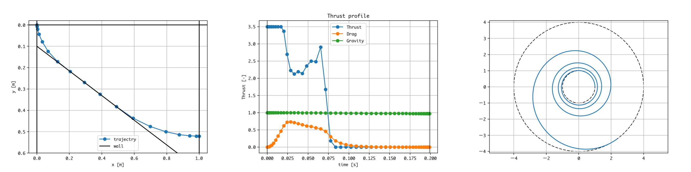

=================================================
OpenGoddard - Trajectory Optimization for Python
=================================================

OpenGoddard is a open source python library designed for solving general-purpose optimal control problems.
OpenGoddard is based on the pseudospectral optimal control theory.

Documentation
=============
**https://istellartech.github.io/OpenGoddard/** (Japanese) — tutorials that relate
equations, code and results, videos of all 15 examples, and the API reference
generated from the docstrings.

Quick start::

  git clone https://github.com/istellartech/OpenGoddard.git
  cd OpenGoddard
  uv sync --locked
  uv run python examples/01_minimum_energy_transfer/main.py
  uv run python examples/02_move_stop/main.py --preset speed_limit --plot

What sort of problems does OpenGoddard solve?
=============================================
Generally speaking, it can adapt to open-loop nonlinear optimal control problems such as aerospace, robot, industry, energy, chemistry etc.
In the field of aerospace, for example, it is possible to generate the optimum trajectory of the spacecraft.

Examples
========

The 15 lesson folders in ``examples/`` are numbered in learning order.
Each contains its implementation in ``main.py`` and a ``README.rst``:

* 01–02: simple transfers, moving and stopping
* 03–05: brachistochrone problems, depth constraints, and spherical geometry
* 06–09: simple rockets, Goddard ascent, and vertical soft landing
* 10–14: single-stage and multistage launch vehicle trajectory optimization
* 15: low-thrust spacecraft orbit transfer

Parameter-driven learning examples are described in
`examples/README.rst <examples/README.rst>`_. Start with the
small analytic transfer, then explore moving and stopping, constrained
brachistochrones, and vertical soft landing before the larger rocket examples.
Each new lesson separates immutable parameters, problem construction, solving,
plotting, and JSON export for future animation or GUI clients::

  uv run python examples/02_move_stop/main.py --preset speed_limit --plot
  uv run python examples/09_soft_landing/main.py --preset variable_mass --plot
  uv run python examples/04_constrained_descent/main.py --output /tmp/descent.json

Features
========
* Easy to install
* Lots of examples
* Readable source code
* Adopt pseudospectral method
* Pseudospectral method of Legendre-Gauss-Lobatto
* Pseudospectral knotting-method
* Easy to scale variable
* use SLSQP(in scipy) for solving nonlinear programming problem (NLP)

Installation
============
::

  $ pip install OpenGoddard

Python 3.15 or later is required. Runtime dependencies are NumPy, SciPy,
and Matplotlib; prerelease dependencies are excluded from the development lock.

Development
===========
Install uv, then run the following commands from the repository root::

  uv sync --locked
  uv run ruff check .
  uv run ruff format --check .
  uv run ty check
  uv run python -m unittest discover -s tests
  uv build

Python is managed by uv using ``.python-version``. Project metadata and tool
settings live in ``pyproject.toml``, and ``uv.lock`` records the resolved
development environment. The package lives in ``src/OpenGoddard``; its import
path remains ``OpenGoddard``. The build backend is ``uv_build``.

Run examples from the repository root. Input data and figure output paths are
resolved relative to each script::

  uv run python examples/03_brachistochrone/main.py

For a small problem with an analytic solution and no plotting, run::

  uv run python examples/01_minimum_energy_transfer/main.py

To update dependencies to newer stable releases and refresh the environment::

  uv lock --upgrade
  uv sync --locked

Usage
=====
::

  from OpenGoddard.optimize import Problem, Guess, Condition, Dynamics

#. Make object that has methods and variables to optimize trajectory
#. Equation of motion
#. Constraint
#. Evaluation function
#. Instantiation of Problem class
#. Installation of an object class that optimizes trajectory
#. Set canonical unit of optimization variable (optional)
#. Guess initial values and set it (optional)
#. Set Problem.functions and knotting condition
#. Solve
#. Post process (visualization)

Numerical conventions and solver results
========================================

States, controls, time arrays and their setters use physical units. ``p`` and
``bounds`` hold dimensionless optimization variables. Changing a unit preserves
existing physical guesses and bounds, including when a unit is changed twice.
Times may start at a nonzero value; phase endpoints are constrained to be
nondecreasing during optimization. Each phase needs at least two LGL nodes, at
least one state and zero or more controls. Lists, tuples and NumPy vectors are
accepted for problem dimensions and initial times.

``cost(problem, obj)`` is the terminal (Mayer) cost. An optional
``running_cost(problem, obj)`` returns the physical-time integrand at every node,
concatenated in phase order. The objective is::

  cost + sum((tf - ti) / 2 * dot(weights, integrand) for each phase)

``cost`` may be omitted for a purely integral objective. If supplied,
``cost_derivative`` must differentiate the complete objective with respect to
the scaled vector ``p``. ``equality`` and ``inequality`` may be omitted;
inequality residuals follow SciPy's convention: feasible values are >= 0.

``solve()`` returns a SciPy ``OptimizeResult`` and stores it in ``problem.result``::

  result = problem.solve(obj, maxiter=100, ftol=1e-9, disp=False)
  if not result.success:
      raise RuntimeError(result.message)

SLSQP options such as ``eps`` are forwarded. Output is quiet unless ``disp=True``;
an unsuccessful result emits ``RuntimeWarning``. ``maxIterator`` limits attempts
after SLSQP's iteration-limit status; other failures stop immediately. Each
solve resets this counter and saves its attempts in ``result_history``.
Time arrays are refreshed before optimization callbacks, so time-dependent
dynamics use the current phase times. Concurrent ``workers`` are unsupported
because callbacks share a mutable problem instance.

Only the LGL optimal-control transcription is implemented. ``method_LG`` and
``method_LGR`` remain available as quadrature/differentiation utilities; passing
``method="LG"`` or ``"LGR"`` to ``Problem`` now raises ``ValueError`` instead
of silently using LGL. Solver success describes the discretized local NLP;
check trajectories with increasing node counts to assess discretization error.
See the `SciPy SLSQP reference
<https://docs.scipy.org/doc/scipy/reference/optimize.minimize-slsqp.html>`_
for stopping criteria and result fields.

Compatibility notes
===================

Imports from ``OpenGoddard.optimize`` continue to work; the four legacy classes
are also available directly from ``OpenGoddard``. Numerical rules, validation and
helper classes are separated into internal modules. The historical executable
demonstrations formerly in ``optimize.py`` are preserved in
``examples/legacy/main.py``. Importing examples does not start optimization.

The corrected running-cost quadrature changes integral objective values:
remove any manually included ``(tf - ti) / 2`` factors from existing integrands.
Physical time arrays now remain in physical units after ``set_unit_time``;
adjust custom code that relied on the old dimensionless arrays. Invalid indices,
array shapes, units and bounds raise explicit exceptions, including under
``python -O``. Negative indices follow normal Python indexing. CSV exports use
the requested delimiter for headers and pad columns missing in a phase with NaN.

Structured derivatives and automatic differentiation
====================================================

The default ``solve()`` still accepts legacy callbacks and uses SLSQP with
finite differences. Opt in to structured derivatives to avoid differencing the
complete collocation system. ``DynamicsModel`` evaluates physical, pointwise
equations of motion::

  from OpenGoddard import DynamicsModel, LinearCallback

  def motion(x, u, t, obj, section, xp):
      # Shapes: x=(states, nodes), u=(controls, nodes), t=(nodes,).
      return xp.stack((x[1], u[0]))

  problem.dynamics = [DynamicsModel(motion)]
  result = problem.solve(obj, derivatives="structured", maxiter=300, ftol=1e-9)

Each output column of ``motion`` must depend only on the same input column.
Cross-node reductions or interpolation violate this contract. The library
assembles exact LGL differentiation and phase-continuity blocks, differentiates
the small local dynamics, and constructs CSR constraint Jacobians. SLSQP receives
dense copies; ``solver="trust-constr"`` consumes the sparse matrices directly.
Structured mode uses central differences and needs no additional dependency.
Difference probes require callbacks defined in a neighborhood of the iterate.

For automatic differentiation, install the optional extra::

  uv sync --locked --extra autodiff

Then select ``derivatives="autograd"``. Use the supplied ``xp`` inside the model,
and use ``view.array_module`` for NumPy operations in cost/constraint callbacks.
Construct residuals with ``view.condition()`` so tracing can flow through them.
Avoid in-place mutation, conversion to Python floats, ordinary ``np.asarray``
on traced values, and non-differentiable external calls. Existing callbacks are
not silently converted or silently downgraded to finite differences.
Autograd differentiates the complete objective, including quadrature durations;
it does not use a manually supplied ``cost_derivative``.

Declare callbacks affine in ``p`` with ``@LinearCallback`` when appropriate::

  @LinearCallback
  def equality(view, obj):
      residuals = view.condition()
      residuals.equal(view.states(0, 0)[0], 0)
      residuals.equal(view.states(0, 0)[-1], 1)
      return residuals()

Their Jacobians are cached once per solve. This declaration is a mathematical
contract: do not mark nonlinear callbacks as linear. Coefficients, units and
``obj`` must remain constant during a solve. Models and callbacks in examples
01, 03, 04, 05 and 12 demonstrate both derivative modes. Redundant inequalities
at endpoints already fixed by equality constraints have been removed there to
avoid degeneracy without changing the feasible trajectories.

The alternative solver is opt-in::

  result = problem.solve(obj, solver="trust-constr", derivatives="autograd",
                         maxiter=600, gtol=1e-8)

It uses matrix-free AD Hessian-vector products as well as sparse Jacobians.
Without AD, SciPy's quasi-Newton Hessian approximation can allocate dense storage.
Use ``gtol``, ``xtol`` and ``barrier_tol`` for trust-constr, rather than SLSQP's
``ftol`` and ``eps``. Restarts use its iteration-limit status 0. Inspect
``result.optimality`` and the trajectory errors as well as ``success``; solver
and derivative choices can follow different local optimization paths.

Adaptive meshes and accuracy checks
===================================

``problem.estimate_error(obj)`` checks the interpolated state derivative against
the dynamics at independent Gauss points, rather than just the original
collocation nodes. It also samples path constraints and box bounds on a denser
LGL mesh. Its dimensionless relative defect is a residual indicator, not a
rigorous bound on state error or continuous feasibility.

``problem.refine([new_nodes_per_phase])`` returns an interpolated warm start.
``solve_adaptive`` performs this refinement automatically::

  result = problem.solve_adaptive(
      obj, derivatives="autograd", tolerance=1e-5,
      max_refinements=5, max_nodes=100, maxiter=600, ftol=1e-8,
  )
  if not result.success or not result.mesh_converged:
      print(result.mesh_history)

The original problem is updated to the final mesh. Phases with excessive ODE
defects grow independently; sampled path violations or failed coarse solves
grow all phases. Failed solves restart refinement from their pre-solve guess.
Per-phase units, endpoint times and discontinuities are preserved. Nodal box
bounds must be constant for each variable within a phase; express varying bounds
as path callbacks instead.

The default ``strategy="p"`` increases node counts within each element. Select
``strategy="h"`` for element splitting, or ``strategy="hp"`` to choose between
splitting and increasing order::

  result = problem.solve_adaptive(
      obj, strategy="hp", derivatives="autograd", tolerance=1e-5,
      max_refinements=12, max_nodes=150, max_elements=24,
      max_order=14, path_check_factor=4, maxiter=600, ftol=1e-10,
  )

Elements live INSIDE logical phases, so section numbers, original phase times,
scales and stage-separation conditions remain unchanged. States are continuous
at internal element interfaces; controls have separate left/right values.
``max_nodes`` counts all nodes per logical phase, including both copies of an
internal interface. ``max_elements`` is also a per-phase limit. ``max_order`` is
the element node-count threshold for selecting splitting over p refinement.
Use ``problem.remesh`` for an explicit partition, e.g.
``problem.remesh([[(-1, 0, 8), (0, 1, 8)]])`` for a one-phase problem.

The h/hp strategies include path constraints between collocation nodes and add
fixed cuts at state/control polynomial extrema when violations remain. Root
locations are recomputed outside optimization and held fixed during each NLP;
the optimizer does not differentiate through moving roots. Affine pointwise
scalar bounds are checked at their polynomial extrema, up to numerical root
accuracy. General nonlinear path constraints are still sampled, not certified.
Callbacks must use physical state/control/time getters and ``view.condition()``;
direct ``p`` indices, mesh-dependent reductions and in-place mutation are not
supported by the sampled view.

``estimate_error`` now checks these extrema for every strategy, in addition to
an independent denser mesh. Its ODE defect is measured in phase coordinates,
so merely shrinking an element cannot artificially improve the indicator.
Node/refinement limits or a successful NLP solve alone do not imply
``mesh_converged``. Inspect ``mesh_stop_reason`` and ``mesh_history`` for h/hp
solves. The splitting locations and smoothness indicators are heuristics, with
no global-optimality or continuous-state-error guarantee.

The Goddard comparison, including independent IVP integration, is documented in
`benchmarks/HP_REPORT.rst <benchmarks/HP_REPORT.rst>`_. Reproduce it with::

  uv run --extra autodiff python benchmarks/compare_hp.py

It loads the previous p implementation from Git revision ``978b97a`` into an
isolated temporary package. It never resets or checks out the working tree.
All solutions receive the same current residual, polynomial-extrema and IVP
checks; historical p and equal-budget p are both reported.

Reproducible performance comparison
===================================

Run ``uv run --extra autodiff python benchmarks/compare_solvers.py`` to compare
full finite differences, structured differences, AD, sparse trust-constr, and
adaptive AD on existing examples 01, 03, 04, 05 and 12. The runner isolates cases
in subprocesses, fixes BLAS thread counts, rotates mode order, repeats each case
three times, records failures/timeouts, and checks between-node accuracy after
timing. One-time imports and AD warmup are excluded; AD has no JIT compilation.

``benchmarks/results.json`` contains timings, objectives, analytic errors where
available, collocation/path/mesh residuals, solver status, versions and source
hashes. ``benchmarks/REPORT.rst`` discusses the measured tradeoffs. These are
local measurements, not a guarantee that a particular solver is always faster.

License
=======
OpenGoddard is an Open Source project licensed under the MIT License

----

==========================================================
OpenGoddard - 連続時間の非線形最適制御問題のためのpythonライブラリ
==========================================================

OpenGoddardはオープンソースな連続時間の非線形最適制御問題を解くpythonライブラリです。
数値解法としては擬スペクトル法を採用しています。

ドキュメント
==========
**https://istellartech.github.io/OpenGoddard/** に、数式・コード・計算結果を対応づけた解説、
15例題の動画、docstringから自動生成したAPIリファレンスをまとめています。

最初の例題の実行::

  uv sync --locked
  uv run python examples/01_minimum_energy_transfer/main.py
  uv run python examples/02_move_stop/main.py --preset speed_limit --plot

どんな問題が解けるか？
===================
一般的に、航空宇宙、ロボット、産業、エネルギー、化学などなどのオープンループな非線形最適制御問題に適応できます。
航空宇宙の分野では例えば、宇宙機の最適な軌道を生成することなどができます。

例
====

``examples/`` の15例を学習順序で番号付けし、1例題1フォルダに統一しています。
各フォルダの ``main.py`` が実装と実行入口、``README.rst`` が説明です。

* 01〜02：簡単な移動、加速して停止する移動
* 03〜05：最速降下、深さ制限、球面への拡張
* 06〜09：単純なロケット、Goddard上昇、鉛直軟着陸
* 10〜14：単段・多段ロケットの上昇と軌道投入
* 15：低推力による軌道遷移

パラメータを変えて比較する新しい教材は
`examples/README.rst <examples/README.rst>`_ にまとめています。
加速・停止の移動、深さ制限付き最速降下、月面への鉛直軟着陸を追加し、
既存例と合わせた学習順序、数式、条件変更の例、GUI・アニメーション向けの
JSON出力形式を説明しています。

特徴
====
* 簡単なインストール - pythonのnumpy, scipy, matplotlibにしか依存していません。
* 複数の例題
* ソースコードの高い可読性
* 非線形最適制御を数値解法のうち、直接法の中の擬スペクトル法を採用
* Legendre-Gauss-Lobattoの擬スペクトル法
* pseudospectral knotting-method
* 簡易な変数スケーリング
* 非線形計画問題（NLP）を解くのはScipyの逐次二次計画法（SLSQP）

インストール
==========
::

  $ pip install OpenGoddard

Python 3.15以上が必要です。開発環境はリポジトリのルートで ``uv sync --locked``
を実行して用意します。設定は ``pyproject.toml``、依存関係の固定は ``uv.lock``、
ソースコードは ``src/OpenGoddard`` に配置しています。

使い方
=====
::

 from OpenGoddard.optimize import Problem, Guess, Condition, Dynamics

#. 軌道の最適化をする物体クラスのメソッドと変数の記述
#. 運動方程式の関数
#. 拘束条件の関数
#. 評価関数の関数
#. Problemインスタンス生成
#. 軌道の最適化をする物体インスタンスの生成
#. 最適化変数の正規化のための単位設定（任意）
#. 初期値の推定と設置（任意）
#. 関数の指定とknotting条件の指定
#. solve
#. ポストプロセス（可視化）

ライセンス
=========
OpenGoddardはMITライセンスのオープンソースプロジェクトです。

---------

References
==========
Fariba Fahroo and I. Michael Ross.  "Costate Estimation by a Legendre Pseudospectral Method", Journal of Guidance, Control, and Dynamics, Vol. 24, No. 2 (2001), pp. 270-277.
http://dx.doi.org/10.2514/2.4709

I. Michael Ross and Fariba Fahroo.  "Pseudospectral Knotting Methods for Solving Nonsmooth Optimal Control Problems", Journal of Guidance, Control, and Dynamics, Vol. 27, No. 3 (2004), pp. 397-405.
http://dx.doi.org/10.2514/1.3426

Qi Gong, Fariba Fahroo, and I. Michael Ross.  "Spectral Algorithm for Pseudospectral Methods in Optimal Control", Journal of Guidance, Control, and Dynamics, Vol. 31, No. 3 (2008), pp. 460-471.
http://dx.doi.org/10.2514/1.32908

Isaac Ross, Christopher D'Souza, Fariba Fahroo, and Jim Ross. "A Fast Approach to Multi-Stage Launch Vehicle Trajectory Optimization", AIAA Guidance, Navigation, and Control Conference and Exhibit, Guidance, Navigation, and Control and Co-located Conferences,
http://dx.doi.org/10.2514/6.2003-5639

Rea, Jeremy Ryan. A legendre pseudospectral method for rapid optimization of launch vehicle trajectories. Diss. Massachusetts Institute of Technology, 2001.
http://hdl.handle.net/1721.1/8608

Rao, Anil V., et al. "Algorithm 902: Gpops, a matlab software for solving multiple-phase optimal control problems using the gauss pseudospectral method." ACM Transactions on Mathematical Software (TOMS) 37.2 (2010): 22.
http://s3.amazonaws.com/researchcompendia_prod/articles/595f4b3cca056a0f35655cad73868234-2013-12-23-01-43-18/a22-rao.pdf

日本語で擬スペクトル法のことが記述されている文献
----------------------------------------

原田正範. "ヤコビ擬スペクトル法による最適化手法の重み関数の高精度計算法." 日本機械学会論文集 C 編 77.784 (2011): 4458-4467.
http://doi.org/10.1299/kikaic.77.4458

原田正範. "ヤコビ擬スペクトル法を用いた最適制御問題の解法における双対変数の推定." 計測自動制御学会論文集 49.8 (2013): 808-815.
http://doi.org/10.9746/sicetr.49.808

原田正範. "高次ガウス・ロバット則の重み関数を用いたヤコビ擬スペクトル法による軌道最適化." 日本機械学会論文集 C 編 73.728 (2007): 1075-1080.
http://doi.org/10.1299/kikaic.73.1075

藤川貴弘, 土屋武司, and 田口秀之. "観測ロケットを利用した極超音速飛行試験: 2 軌道検討." title 平成 24 年度宇宙輸送シンポジウム: 講演集録 Proceedings of Space Transportation Symposium: FY2012. 2013.
https://repository.exst.jaxa.jp/dspace/handle/a-is/14011
