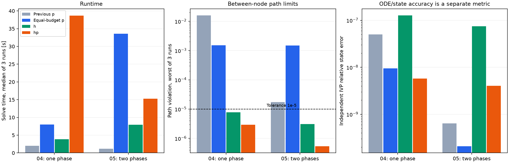

Goddard: p・h・hp適応の比較
========================================================

目的は、前回のp適応で残ったノード間の経路制約違反を改善し、計算時間と状態精度を別々に評価すること。
対象は既存例題04（1区間）と05（2区間、最初の終端時刻0.075固定）。最適化モデルの物理条件は同じ。

実装
----------------------------------------

* 論理区間の内部にLGL要素を導入。h分割後も既存のsection番号・区間端時刻・スケールを維持する。
* 内部境界では状態のみ連続にし、制御には左右独立の値を持たせる。要素ごとに補間・積分する。
* hは次数を保って要素分割、hpはLegendre係数の高次成分と残差に応じて次数増加または分割を選ぶ。
  1反復で最大2要素を変更する。分割点と滑らかさ判定はヒューリスティックで、文献の特定アルゴリズムの再現ではない。
* 経路制約を元のノードだけでなくGauss点にも課し、状態・制御多項式の極値で違反があれば固定した制約点を追加して再最適化する。
  追加点を固定してからADするため、移動する多項式根を微分しない。
* ODE残差は要素座標から論理区間座標へ戻して測定。hを小さくするだけで残差指標が小さくなることを避ける。
* 本比較はh/hpと経路制約生成を組み合わせた実装の評価であり、分割だけの寄与の切り分けではない。

再現条件
----------------------------------------

* 前回pのソース: Git ``978b97a43767277076bcbebe0db31134d0f2ce96``。一時ディレクトリに読み出して独立したパッケージ名で実行。
* 作業ツリーのcheckout/resetは行わない。全方式は同じ例題の初期推定から開始し、初期ノードは各論理区間12。
* 前回p: max_refinements=5、max_nodes=100、SLSQP ftol=1e-8。前回の設定を再現。
* p/h/hpの同予算比較: max_refinements=12、max_nodes=150（各論理区間の合計）、ftol=1e-10。
  h/hpはmax_elements=24、max_order=14、path_check_factor=4。全方式でmaxiter=600、maxIterator=1、ADを使用。
* 共通メッシュ許容値1e-5。各条件3回、独立プロセス、BLASスレッド数1、実行順を回転。実行時間は中央値。
* 初期化・import・ADウォームアップ・最後の共通検証は時間外。適応内部の誤差推定・補間・制約追加・再最適化は時間に含む。
* 環境: macOS-26.2-arm64-arm-64bit-Mach-O; Python 3.15.0; NumPy/Scipy/autogradのバージョンとソースSHA-256はJSON参照。
* 基準コミットのネイティブ評価指標に依存せず、すべての解を現実装で再検証する。

計算時間と経路制約
----------------------------------------

.. csv-table:: 時間は秒、経路違反は3回の最悪値
   :header: "例題", "方式", "秒・中央値", "最終ノード", "論理区間内の要素数", "経路違反", "共通検証合格"

   "04", "previous-p", "1.9939", "[93]", "[1]", "0.01602", "0/3"
   "04", "p", "8.0191", "[150]", "[1]", "0.001503", "0/3"
   "04", "h", "3.8557", "[48]", "[4]", "7.826e-06", "3/3"
   "04", "hp", "38.6771", "[132]", "[10]", "2.906e-06", "3/3"
   "05", "previous-p", "1.1875", "[93, 93]", "[1, 1]", "1.729e-05", "0/3"
   "05", "p", "33.5786", "[150, 150]", "[1, 1]", "0.001482", "0/3"
   "05", "h", "7.9514", "[48, 24]", "[4, 2]", "3.073e-06", "3/3"
   "05", "hp", "15.2936", "[56, 26]", "[4, 2]", "5.337e-07", "3/3"

h/hpの合否はNLPソルバーのsuccessだけではなく、独立した点のODE残差と経路違反が両方1e-5以下かで決める。
max_nodesは内部境界の左右の重複ノードも含む。論理区間数は04が1、05が2のまま。

ODE・独立積分による状態精度
----------------------------------------

* ODE指標: 独立Gauss点（要素ノード数の4倍+1）で相対的な微分残差を測る。
* 経路違反: 独立LGL点、状態・制御多項式の極値、および追加のGauss点（16倍+1）で再検証する。
  Goddardの不等式は状態・制御のスカラー上下限なので極値検査が重要。一般の非線形制約を区間全体で保証するものではない。
* IVP: 得られた制御を区分多項式として用い、solve_ivpで物理運動方程式を再積分する。
  内部境界ごとに積分区間を分け、状態をリセットせず前区間の終状態から引き継ぐ。rtol=1e-10、atol=1e-12。
* IVP指標: 再積分状態と最適化状態多項式の差を、状態の基準単位+状態の大きさで割った最大値。
  これは数値積分との比較であり、厳密な誤差上界ではない。異なる物理問題同士の順位付けには使わない。

.. csv-table:: 各方式の最後の試行（各試行の詳細はJSON）
   :header: "例題", "方式", "目的値", "ODE残差", "IVP相対状態誤差", "NLP等式残差"

   "04", "previous-p", "-1.01282448809", "4.787e-06", "5.017e-08", "2.311e-10"
   "04", "p", "-1.01283457685", "1.45e-06", "9.483e-09", "8.905e-13"
   "04", "h", "-1.01282735363", "8.395e-06", "1.28e-07", "4.743e-12"
   "04", "hp", "-1.01283351332", "1.458e-06", "5.778e-09", "1.493e-13"
   "05", "previous-p", "-1.01282228912", "2.472e-10", "6.398e-10", "3.547e-12"
   "05", "p", "-1.01283424959", "1.792e-09", "2.071e-10", "9.102e-12"
   "05", "h", "-1.01283401182", "2.291e-06", "7.483e-08", "5.305e-13"
   "05", "hp", "-1.01283429706", "2.081e-07", "4.043e-09", "1.079e-12"

状態誤差と経路制約違反は別の量。pのIVP誤差が小さくても、推力が上下限を超えていれば実行可能な軌道とは言えない。
次数を上げたりNLP許容値を厳しくしたりしても、非凸問題の局所解や補間の振動が変わるため、
経路制約違反の単調な改善は保証されない。制約違反を伴う、より良い目的値を性能向上とは扱わない。

使い分け
----------------------------------------

* 今回のGoddardでは、まずhを使い、経路制約を満たす軌道を得るのが実用的。
* hpがhより速いとは限らない。特に例題04では、より良い目的値・状態精度のための追加計算が大きい。
* 前回pは短時間だが経路制約未達。同予算pはさらに時間を掛けても経路制約未達となった。
* 上限到達・粗いNLPの失敗はmesh_historyとmesh_stop_reasonに残り、収束成功には数えない。
* 既存の論理区間を自動的に増やしてコールバックのsection番号を変えることはしない。

実行
----------------------------------------

::

   uv sync --locked --extra autodiff
   uv run --extra autodiff python benchmarks/compare_hp.py
   uv run python benchmarks/render_hp_report.py

hp_results.jsonには個別時間、全履歴、警告、NLP状態、独立検証、IVP差、環境、ソースハッシュがある。
hp_results.txtは全条件の一覧。タイムアウト・実行失敗はランナーが記録し、成功例だけを選別しない。

参考
----------------------------------------

* Patterson, Hager, Rao, A ph mesh refinement method for optimal control:
  https://doi.org/10.1002/oca.2114 （次数増加と区間分割を組み合わせる背景。ここでのLGL実装とは異なる。）
* SciPy BarycentricInterpolator: https://docs.scipy.org/doc/scipy/reference/generated/scipy.interpolate.BarycentricInterpolator.html

