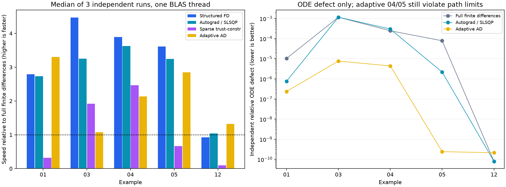

疎ヤコビアン・自動微分・メッシュ適応の比較
================================================================

2026-10-18、既存例題01・03・04・05・12に対するローカル測定。
結果の完全な数値は ``results.json``、全25条件の一覧は ``results.txt`` に保存。
同じ初期値・単位・制約を用い、微分方式とソルバーを比較した。
ここでの基準は現在のコード上の全変数有限差分SLSQPであり、2017年版全体との速度比較ではない。

優先順位と実装
--------------------------------

1. 構造を使った微分：スペクトル微分・区間接続の厳密ブロックと局所運動方程式の微分をCSRで組み立てる。
   SLSQPには密配列へ変換して渡し、trust-constrにはCSRを渡す。
2. 自動微分：任意依存autogradで局所運動方程式、境界・経路条件、積分を含む目的関数を微分する。
   明示的に線形と宣言したコールバックのヤコビアンを各solve内で再利用する。
   trust-constrでは密ヘッセ行列を作らずADヘッセ行列ベクトル積を使う。
3. メッシュ適応：独立した点で残差を測り、必要な区間のノードを増やし、補間した解から再最適化する。
   既存の区間番号の意味を保つp適応であり、区間の自動分割は行わない。

測定条件
--------------------------------

* macOS-26.2-arm64-arm-64bit-Mach-O; Python 3.15.0; NumPy 2.5.4; SciPy 1.18.1; autograd 1.9.1。
* 各条件3回、各回を独立プロセスで実行。BLASスレッド数1、方式の実行順を回転。以下は実行時間の中央値。
* SLSQP: ftol=1e-8、trust-constr: gtol=1e-8。いずれもmaxiter=600、maxIterator=1。
  ftolとgtolは異なる停止基準なので、同じ数値でも同じ精度を保証しない。
* 初期化・一度限りのimport/ADウォームアップ・最終誤差評価は時間外。ADにJITコンパイルはない。
  適応方式の内部の誤差推定、補間、再最適化は実行時間に含む。
* 適応の初期ノードは各区間max(6,min(12,n//2))。tolerance=1e-5、最大5回細分化、各区間最大100ノード。
* 例題03には境界条件を満たす初期推定を追加し、01・04・05では等式に重複する端点不等式を削除。
  これらは全方式に共通。実行中のコードのSHA-256はJSONに記録。

速度
--------------------------------

.. csv-table:: 秒（中央値）。AD比は基準/ADで、大きいほど高速。
   :header: "例題", "有限差分", "構造差分", "AD/SLSQP", "疎trust-constr", "適応AD", "AD比"

   "01 Brachistochrone", "0.7182", "0.2575", "0.2628", "2.2505", "0.2175", "2.73x"
   "03 2D rocket", "0.7431", "0.1663", "0.2283", "0.3876", "0.6913", "3.25x"
   "04 Goddard (1 phase)", "4.4068", "1.1321", "1.2148", "1.7855", "2.0635", "3.63x"
   "05 Goddard (2 phases)", "3.4733", "0.9617", "1.0704", "5.2111", "1.2209", "3.24x"
   "12 Energy transfer", "0.0165", "0.0179", "0.0159", "0.1715", "0.0125", "1.04x"

全75回でNLPソルバーはsuccess=True。01・03・04・05ではAD/SLSQPが基準の約2.7〜3.6倍、
構造差分は約2.8〜4.5倍速かった。小さい例題12では差は小さく、疎ソルバーの準備コストが支配的。
疎trust-constrは例題01・05ではSLSQPより遅い。疎行列という理由だけで既定値にはしない。

ノード間の精度
--------------------------------

ODE指標は独立したGauss点における
``max|dX/dtau - (tf-ti)f/2| / (unit + max|X|)`` の全状態・区間の最大値。
解の真の誤差上界ではない。経路違反はさらに密なLGL点での不等式・変数境界の最大違反。
コールバックのスケーリングに依存する量であり、単位の異なる別問題同士の比較には使わない。

.. csv-table:: 基準と適応方式の比較
   :header: "例題", "基準ODE", "適応ODE", "適応経路違反", "最終ノード", "mesh_converged"

   "01", "1.03e-05", "2.37e-07", "0", "[15]", "True"
   "03", "0.00116", "7.67e-06", "0", "[53]", "True"
   "04", "0.000246", "4.4e-06", "0.0144", "[93]", "False"
   "05", "7.84e-05", "2.41e-10", "1.32e-05", "[93, 93]", "False"
   "12", "7.97e-11", "2.14e-10", "0", "[6]", "True"

01・03・12はODE残差とサンプルした経路違反がともに許容値内。
04・05はODE残差が改善しても推力切り替え付近の補間による経路違反が残り、mesh_converged=False。
成功扱いのNLPだけを見て連続時間の精度を判断してはならない。特に04・05の疎ソルバーの
より良い目的値も、ノード間の経路違反を伴うため連続時間で優れた軌道とは断定できない。

.. csv-table:: 目的値（方式で局所解や離散化が変わる）
   :header: "例題", "基準", "構造差分", "AD", "疎", "適応"

   "01", "1.77245391688", "1.77245385088", "1.77245385118", "1.77245388147", "1.77245385076"
   "03", "2.08492343028", "2.08499294077", "2.0849234301", "2.08492343001", "2.08489396766"
   "04", "-1.012806555", "-1.01280959173", "-1.01280952722", "-1.01283438855", "-1.01282448809"
   "05", "-1.01280721747", "-1.01281424564", "-1.01281413678", "-1.01283605365", "-1.01282228912"
   "12", "3.99999999953", "3.99999999953", "3.99999999953", "4", "3.99999999937"

03の構造差分の目的値はADに比べ約6.95e-5高い。同じ停止許容値でも有限差分誤差や
反復経路により局所解が異なり得る。速度向上と解の同一性を分けて評価する必要がある。

解析解で確認できる例題
--------------------------------

01はg=L=1、自由な終端高さの最速降下で最適時間sqrt(pi)。12は距離2の
``T + integral(u^2 dt)`` なのでT=2、u=1、目的値4。

.. csv-table:: 解析目的値との絶対差
   :header: "例題", "基準", "AD", "適応"

   "01", "6.6e-08", "2.71e-10", "1.42e-10"
   "12", "4.69e-10", "4.67e-10", "6.32e-10"

使い分けと限界
--------------------------------

* 最初にDynamicsModelと線形コールバックの宣言を導入し、依存追加なしのstructuredを評価する。
* 正確な微分や非線形の強い運動方程式にはautogradを選び、基準との差も確認する。
* メッシュ精度が必要ならsolve_adaptiveを使い、successとmesh_convergedを両方確認する。
* 点ごとの独立性、線形宣言、AD対応の配列演算は利用側の明示的な契約。任意の旧コードを自動変換しない。
* p適応では不連続制御のGibbs振動を取り除けない場合がある。次の優先課題は、
  既存の区間番号や段分離条件を保つモデル表現を設計した上でのh/hp適応と、経路制約の区間内保証。
* 非凸問題の大域最適性、区間内の完全な制約充足、別のハードウェアでの同じ速度は保証しない。

再実行
--------------------------------

::

   uv sync --locked --extra autodiff
   uv run --extra autodiff python benchmarks/compare_solvers.py

JSONには各試行の状態・警告・ノード・反復数・目的値・残差・環境・ソースハッシュがある。
適応方式のiterations/nfevは最終solveの値で、各段階の反復数はmesh_historyを参照する。

参考
--------------------------------

* SciPy trust-constr: https://docs.scipy.org/doc/scipy/reference/optimize.minimize-trustconstr.html
* SciPy SLSQP: https://docs.scipy.org/doc/scipy/reference/optimize.minimize-slsqp.html
* HIPS/autograd: https://github.com/HIPS/autograd

